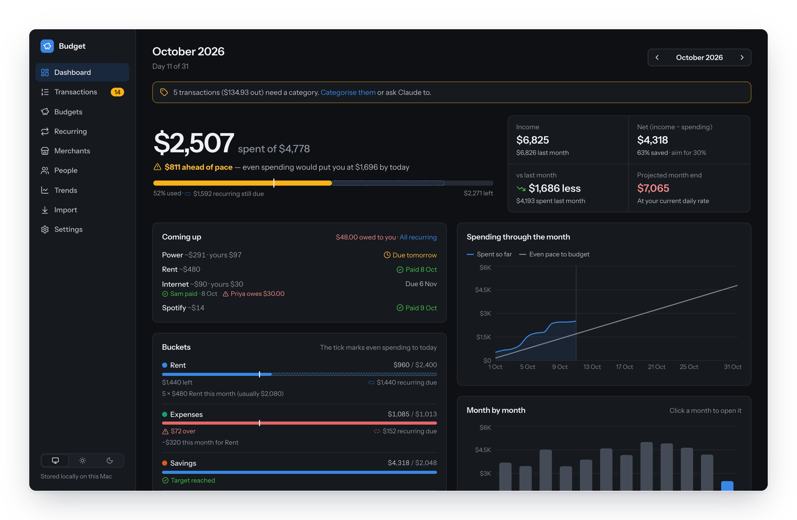
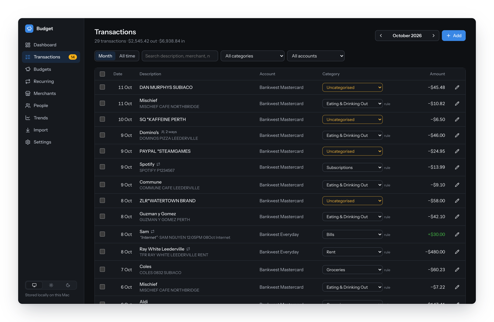
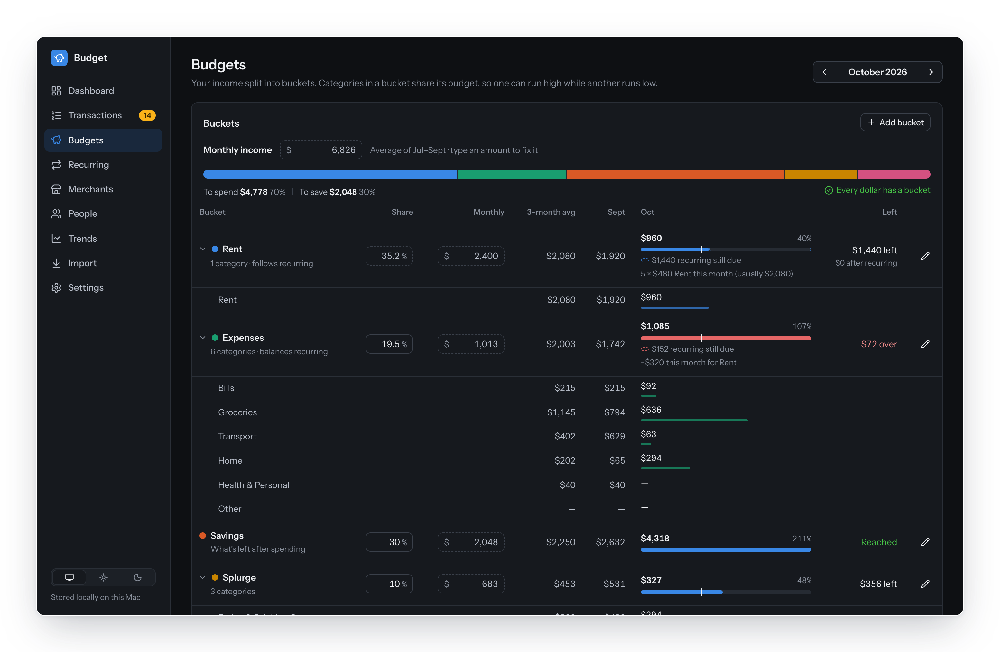
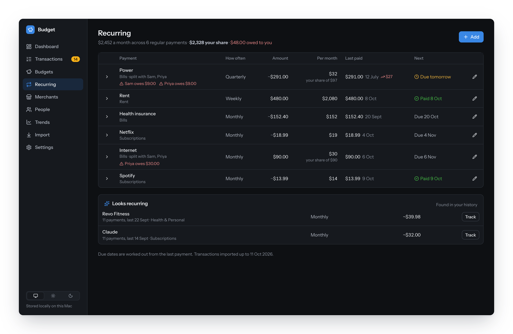
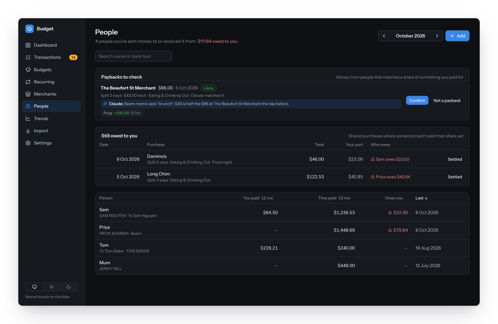
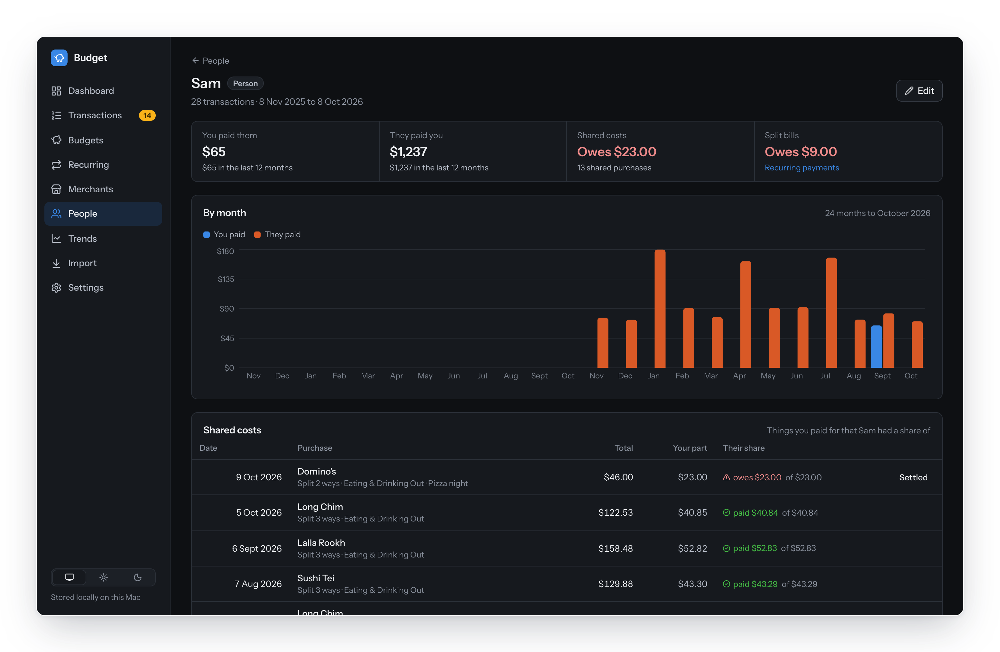
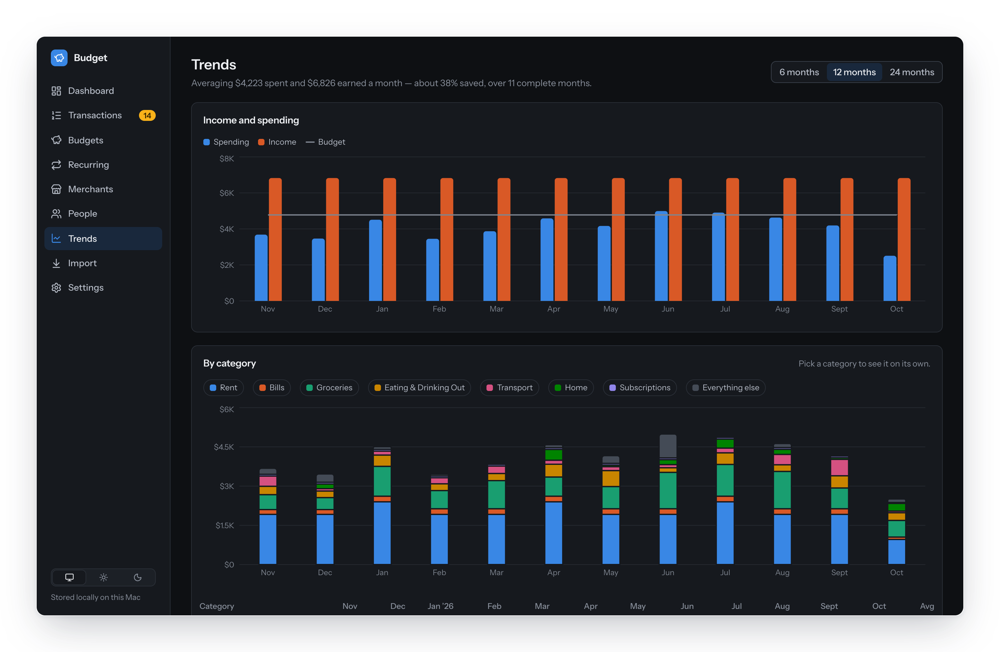

<div align="center">


# Budget

**A local budgeting app that Claude keeps up to date.**

Hand Claude a bank statement. It imports and checks the transactions, cleans up the merchant names, sorts everything into categories and works out who's paid you back. The dashboard shows where the month is heading. Everything stays in one SQLite file on your own machine.

<sub>TypeScript · React · SQLite · Model Context Protocol · built for Australian banks, works with most CSVs</sub>

<br>



</div>

## What's different

- **Claude does the data entry.** It imports statements, names every payee, writes rules and records paybacks through 40 MCP tools. You just review.
- **Statements have to balance.** Claude checks a PDF's lines against its opening and closing balances before importing.
- **No bank login.** Import a CSV or PDF. Your data stays in one SQLite file on your machine.
- **Splits live on real transactions.** Paybacks are matched to what they paid for, so your spending shows only your share and the People page shows who owes you.
- **Shared bills per housemate.** See who's paid, who you're waiting on and who's behind, bill by bill.
- **Budgets that fit your schedule.** Percentage buckets, weekly rent at four or five payments a month, and quarterly bills spread evenly.

## A tour

### Claude imports and categorises

```text
> Import ~/Downloads/everyday-october.pdf and categorise everything

Read 4 pages, 87 transactions. Dry run: opening $1,204.18 + net −$312.40 = closing $891.78 ✓
Imported 85, skipped 2 exact duplicates from last week's CSV.
Categorised 79 with existing rules. For the other 6:
  MIKROY PTY LTD → Zambrero (Eating & Drinking Out), added a rule
  SQ *KAFFEINE PERTH → Kaffeine (Eating & Drinking Out), added a rule
  ...
Sam sent $40.84 "Dinner" on 6 Oct: a third of the $122.53 at Long Chim the day before. Confirmed.
Priya's $43 Beem payment probably covers half of Sunday's brunch. I've left it on the People page for you to check.
```

The flow is always the same: a dry run, then the reconciliation check, then the real import. After that Claude categorises, matches paybacks, and finishes with a month summary and a look at recurring payments. Unknown Australian merchant names ("MIKROY PTY LTD") are looked up before Claude asks you. Anything it isn't sure about is left uncategorised rather than guessed. Every import can be undone.

### Transactions

Each transaction shows a friendly payee name above the bank's raw text, what the other person wrote on a transfer (the **memo**, kept word for word), and your own **notes**. Rules match on words, so `IGA` doesn't catch `GIGABYTE`.



### Budgets as buckets

Your planned income (a 3-month average, or a figure you type in) is split into buckets such as Rent, Expenses, Savings, Splurge and Travel. Categories in a bucket share its budget, so groceries can run high in a month when transport runs low. A bucket can follow its recurring payments instead: rent is $1,920 in a four-Thursday month and $2,400 in a five-Thursday one, and another bucket gives or takes the difference so the plan still adds up to 100%.



### Recurring bills, shared with housemates

Rent, power, internet and subscriptions are tracked one by one, with what's due next and what each housemate owes on each bill. The app spots payments that look regular and suggests tracking them.



### People and paybacks

Money coming in from people is checked against what you paid for. Clear matches are confirmed, and likely ones wait for you with Claude's reasoning attached. Shares nobody has paid yet stay listed until they're settled, either by a transfer or by marking them settled when someone pays in cash.



Each person and merchant has a page with everything that's gone between you, month by month.



### Trends

Income against spending for 6, 12 or 24 months, broken down by category.



## Features

<table>
<tr><td valign="top" width="50%">

**Getting data in**
- Claude reads PDF statements and checks them against the opening and closing balances
- CSV upload on the Import page, or `import_csv_file` over MCP
- Reads Bankwest and Up exports and most other bank CSVs, with or without a header row
- Exact duplicates are skipped. Near-duplicates (same date and amount, different wording) are held back for you to check
- Pending card purchases come in flagged as pending and count straight away. A later import swaps each for its settled version (keeping its category, payee and splits), or removes it if it never settles. $0 rows are skipped
- The Import page shows which dates each account's imports cover and flags gaps. Where the bank gives running balances, a gap is checked against them, so a quiet week isn't flagged and a missing one shows how much is missing
- Any import can be undone

**Keeping it tidy**
- Payees: one friendly name per shop or person, shared by every transaction
- Rules set a category, a payee, or both
- Merge or rename payees and categories, and every transaction follows
- The memo (what they wrote) is kept apart from your notes

</td><td valign="top" width="50%">

**Planning**
- Buckets as a % of income or a fixed amount
- Rent can follow its weekly payments, with a balancing bucket
- Quarterly and yearly bills are spread across the months
- Pace: how far ahead or behind even spending you are today
- Click a bucket on the dashboard to see the transactions behind it
- Projected month end at your current daily rate

**Sharing costs**
- Split any purchase n ways, even before anyone's paid
- Paybacks are matched by amount, timing, the sender's message and who else paid
- Shared bills with contributors: paid, waiting or owing for each bill
- Settle shares that were paid outside the bank

**Everything else**
- Light and dark themes, works on a phone, installable as a home-screen app
- JSON backup from Settings

</td></tr>
</table>

## Getting started

You'll need Node.js 22 or later.

```sh
git clone <this repo> budgeting && cd budgeting
npm install
npm run demo      # a year of made-up data in data/demo.db, at http://127.0.0.1:4777
```

When you're ready to use your own data:

```sh
npm start         # builds the UI and serves it at http://127.0.0.1:4777
```

`npm run dev` gives you hot reload (UI on http://127.0.0.1:5173). `PORT=4800 npm start` runs it on another port.

### Connect Claude

**Claude Code:** the `budget` MCP server is registered in `.mcp.json`. Start `claude` from the project folder and approve the server when asked.

```sh
claude
> Import ~/Downloads/statement.pdf and categorise everything
```

The MCP server restarts itself whenever the code under `src/` changes, so Claude always has the current tools. The `transfer-review` skill in `.claude/skills/` covers working out what each payment from a person was for.

**Claude Desktop:** add this to `~/Library/Application Support/Claude/claude_desktop_config.json`, using your own path:

```json
{
  "mcpServers": {
    "budget": {
      "command": "node",
      "args": [
        "/path/to/budgeting/node_modules/tsx/dist/cli.mjs",
        "/path/to/budgeting/src/mcp/launcher.ts"
      ]
    }
  }
}
```

### Tell Claude about your money

Claude does a better job when it knows which accounts are yours, who keeps showing up in your statements and how you like things categorised. Write that in `data/context.md`. `CLAUDE.md` loads it at the start of every session, and like everything else in `data/` it's gitignored, so it stays on your machine. If the file doesn't exist, Claude asks as things come up and can start it for you.

A good one covers:

```markdown
# My context

## Accounts
- `Everyday` is my main account and `Savings` gets a transfer every payday. Moving money between them is `Transfers`.
- Paid monthly on the 15th by Acme Engineering. The $40 phone allowance goes in `Bills`, not income.

## People
- Sam and Priya are housemates. Sam pays $480 rent to the agent every Thursday and I transfer him my share.
  They each pay a third of the internet (Aussie Broadband) and power (Synergy, quarterly).
- Mum (JENNY HILL on statements) pays me back for things I buy for her, usually in full, with a note naming the item.

## Categories and budgets
- Streaming and phone subscriptions go in `Bills`. Work software goes in `Business`.
- Buckets: Rent follows its weekly payments, Expenses 20% (balances Rent), Savings 30%, Splurge 10%, Travel 10%.
```

Refer to accounts by the names you gave them in the app, and leave out BSBs and account numbers. Claude doesn't need them: each account's number is stored with your imports, and the `budget` tools look it up when a CSV covers several accounts.

Claude adds to it as it learns things, such as a new housemate or a merchant you always put in the same category.

## How it counts

- **Spending** is money out in spending categories, net of refunds and paybacks in the same category, plus anything not yet categorised.
- **Income** is money in, in income categories.
- **Transfer** categories (moving money between your own accounts, paying off a credit card) are left out of both, so a card purchase isn't counted again when you pay the card off.
- **Pace** compares what you've spent with where even spending would put you by today. The tick on each bar marks that point.
- **Owed** is each person's unsettled shares, less the paybacks allocated to them.

## Your data

- Everything personal lives in `data/`: the database (`data/budget.db`), your context for Claude (`data/context.md`), backups, and any screenshots you give Claude (`data/beem/`). Back up by copying the folder, or use **Settings → Download JSON backup** for the transactions.
- `.gitignore` covers `data/`, every database file, statements (`*.pdf`, `*.csv`, `*.ofx`, `*.qif`, spreadsheets) and local Claude settings. That protects anyone who clones the repo, not just the author.
- The server binds to `127.0.0.1` only. To reach it from your phone, put it behind something like `tailscale serve` rather than opening a port.

### Why not connect to the bank directly?

Most Australian banks don't offer a personal API. Live feeds go through the Consumer Data Right, which only accredited data recipients can use, so in practice that means signing up with a third-party aggregator. For a private, local tool, a CSV export every week or so plus Claude for PDFs is simpler, and your banking data stays off other people's servers. Exporting weekly keeps the "how am I tracking this month" view accurate.

## Development

```
src/core/     schema and migrations, import/dedupe/reconciliation, CSV parsing, reports, payees, splits, recurring
src/server/   Express API and the built UI
src/mcp/      MCP server for Claude, plus the launcher that reloads it on changes
web/          React + Recharts dashboard
tests/        vitest tests for the core
scripts/      demo data and README screenshots
```

```sh
npm test              # core tests
npm run typecheck     # TypeScript
npm run screenshots   # rebuild docs/screenshots from the demo data (uses your installed Google Chrome)
```

Schema changes go in a new entry at the end of `MIGRATIONS` in `src/core/db.ts`. Tests, fixtures and the demo use invented people and account numbers only.
